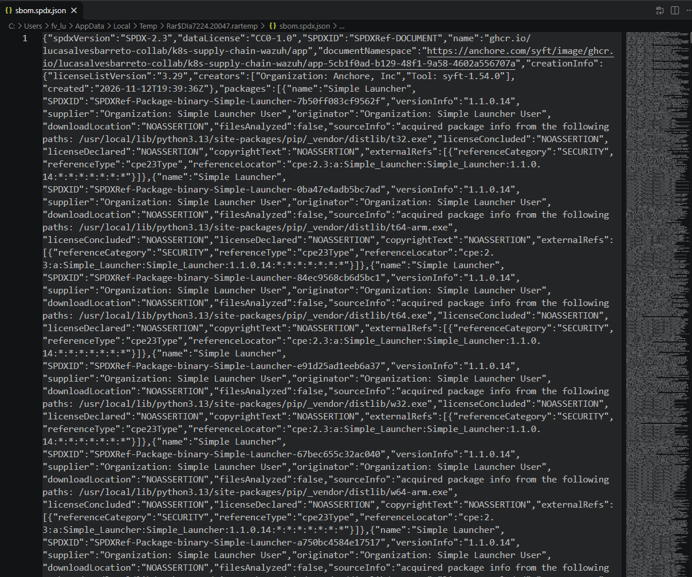
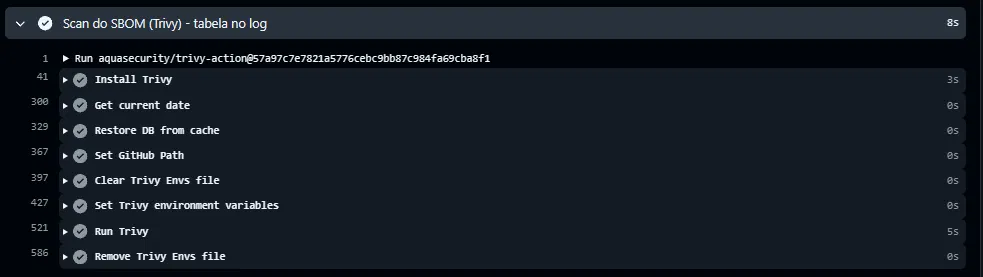

# k8s-supply-chain-wazuh

Cadeia de suprimento de software segura em Kubernetes (k3s), com detecção em
runtime integrada ao Wazuh e mapeada ao MITRE ATT&CK for Containers.

> Status: em andamento. Fases 0 e 1 concluídas. Próxima: Fase 2 (admissão
> com Kyverno).

## O que a Fase 1 já prova

| Controle | Como foi provado |
|---|---|
| Actions fixadas por hash de commit | Todas as linhas `uses:` têm 40 caracteres hexadecimais; Dependabot propõe atualizações |
| SBOM (SPDX) da imagem | Gerado pelo Syft a cada build; guardado como artefato |
| Scan que bloqueia | Teste negativo (exceção vencida: build vermelho) e positivo (exceção válida: verde) |
| Scan detecta falhas de verdade | `requests==2.19.0` em branch de teste elevou o resultado de 0 para 7 |
| Assinatura sem chave (Cosign keyless) | Verificada de fora do pipeline, na VM, com identidade do workflow |
| Assinatura presa à branch de origem | Imagem da branch de teste foi recusada ao exigir a identidade da `main` |
| Proveniência SLSA (Build Level 2) | `cosign verify-attestation` mostra imagem, workflow, referência e commit exato |

Detalhes dos problemas reais e das decisões: [docs/jornada.md](docs/jornada.md).
O que este projeto **não** garante: [docs/limitacoes.md](docs/limitacoes.md).

## Fluxo do pipeline

~~text
push na main
  -> build da imagem (Buildx) e publicação no GHCR
  -> SBOM SPDX (Syft)
  -> scan da imagem (Trivy) -- falha o build se houver CVE sem exceção válida
  -> assinatura keyless (Cosign) por digest
  -> proveniência SLSA (attest-build-provenance)
~~

## Fases

| Fase | Tema | Estado |
|------|------|--------|
| 0 | Ambiente (k3s, VM) | Concluída |
| 1 | Pipeline: SBOM, scan bloqueante, assinatura, proveniência | Concluída |
| 2 | Admissão com Kyverno | Pendente |
| 3 | IaC com Checkov / Trivy config | Pendente |
| 4 | Falco + Wazuh (regras 1002xx) e playbook N1 | Pendente |

## Ambiente

- k3s em nó único (traefik e servicelb desativados)
- VM Ubuntu com 4 vCPU e 7,2 GiB de RAM (Wazuh ocupa cerca de 2,7 GiB)

## Projeto anterior

Este projeto continua o laboratório [wazuh-mitre-attack-lab](https://github.com/lucasalvesbarreto-collab/wazuh-mitre-attack-lab), de detecção mapeada ao MITRE ATT&CK.

## Evidências

